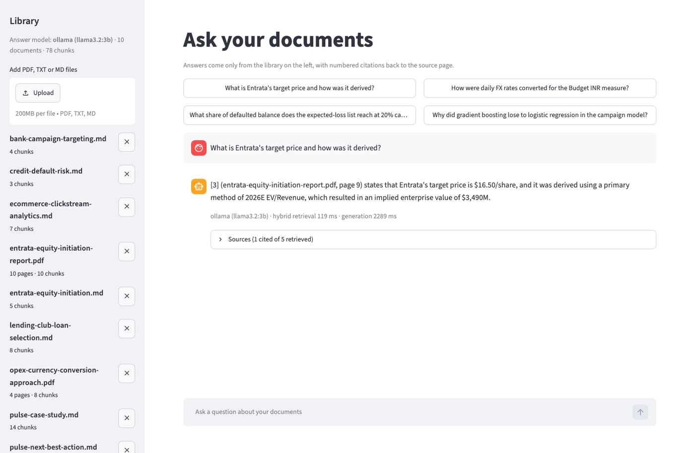
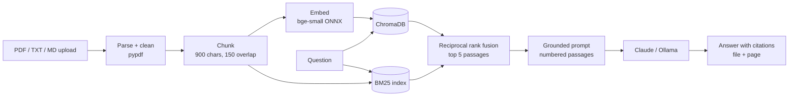

# RAG Document Q&A

Upload PDFs or text files and ask questions. The system retrieves the most relevant passages with
**hybrid search (vector + BM25)**, and an LLM answers **only from those passages, with numbered
citations** back to the file and page. If the answer isn't in the documents, it says so.

**Try it live:** [in-browser demo](https://akapraveen.github.io/#rag). Upload your own PDF or ask about
the sample library, no install needed. The browser version ranks passages with BM25 and quotes the
best-matching sentences with citations; this repository adds embeddings, ChromaDB and LLM-written answers.



| Layer | Choice |
|---|---|
| Parsing and chunking | `pypdf`, LangChain `RecursiveCharacterTextSplitter` (900 chars, 150 overlap, heading-aware) |
| Embeddings | `BAAI/bge-small-en-v1.5` via FastEmbed (local ONNX, no GPU or API key) |
| Vector database | ChromaDB (persistent, cosine) through `langchain-chroma` |
| Keyword search | BM25 (`rank-bm25`) with stop-word removal |
| Fusion | Reciprocal rank fusion (k = 60) over the top 20 of each |
| LLM | Claude (`claude-opus-5`, Anthropic SDK) or a local model via Ollama; extractive mode needs no LLM |
| Backend / frontend | FastAPI / Streamlit, Docker Compose for both |



## Results

Evaluated on the bundled sample library (10 documents: 2 PDFs and 8 Markdown write-ups, 78 chunks)
with 22 questions whose answers and source documents are known ([`eval/questions.jsonl`](eval/questions.jsonl)).

| Retrieval (22 questions) | hit@1 | hit@3 | hit@5 | MRR |
|---|---|---|---|---|
| Vector (bge-small) | 0.91 | 1.00 | 1.00 | 0.947 |
| BM25 | 0.95 | 1.00 | 1.00 | 0.977 |
| **Hybrid (RRF)** | 0.91 | **1.00** | **1.00** | 0.955 |

| Answer model (hybrid retrieval, top 5) | Answers containing the expected fact |
|---|---|
| `gemma3:1b` via Ollama | 64% |
| `llama3.2:3b` via Ollama | **86%** |

- The right source was in the top 3 passages for every question in every mode, so remaining answer
  errors come from the model reading tables, not from retrieval. A larger model is the lever.
- On this small, number-heavy corpus BM25 alone is strongest at rank 1. Hybrid is the default because
  paraphrased questions ("how long is labour covered?") are where vector search earns its place, and
  it never dropped a correct source out of the top 3.
- Results files: [`eval/results_llama3.2-3b.json`](eval/results_llama3.2-3b.json), [`eval/results_gemma3-1b.json`](eval/results_gemma3-1b.json).
  With `ANTHROPIC_API_KEY` set, `make eval-answers` scores Claude on the same questions.

## Run it

```bash
python -m venv .venv && source .venv/bin/activate
pip install -r requirements.txt
cp .env.example .env               # add ANTHROPIC_API_KEY, or: ollama pull llama3.2:3b
uvicorn app.api:app --port 8000    # API + OpenAPI docs at http://localhost:8000/docs
streamlit run ui/streamlit_app.py  # UI at http://localhost:8501
```

Or with Docker: `docker compose up --build` (API on 8000, UI on 8501; Ollama on the host is reachable
via `host.docker.internal`).

With no API key and no Ollama model, the app still works in **extractive mode**: it quotes the
sentences from the retrieved passages that best match the question, each with its citation.

## API

| Method | Path | Does |
|---|---|---|
| `GET` | `/health` | Answer model in use, document and chunk counts |
| `GET` | `/documents` | Library contents |
| `POST` | `/documents` | Upload one or more PDF / TXT / MD files (multipart `files`), max 25 MB each |
| `DELETE` | `/documents/{doc_id}` | Remove a document from both indexes |
| `POST` | `/search` | Retrieval only: `{"question", "top_k", "mode"}` returns ranked passages |
| `POST` | `/ask` | Retrieve and answer: returns `answer`, `sources` (with `cited` flags, ranks, pages) and timings |

```bash
curl -F "files=@handbook.pdf" localhost:8000/documents
curl -X POST localhost:8000/ask -H "content-type: application/json" \
     -d '{"question": "How many days of leave do new joiners get?", "top_k": 5, "mode": "hybrid"}'
```

## Design decisions

- **Grounding over fluency.** The prompt numbers each passage with its file and page, requires a
  citation on every factual sentence, and gives the model an exact sentence to use when the answer is
  missing. An unrelated question ("Who won the 2018 World Cup?") returns that sentence, not a guess.
- **Hybrid retrieval.** Financial documents are full of exact tokens (tickers, `FX_Key`, `$16.50`)
  that embeddings blur; BM25 catches those, vectors catch paraphrases, and RRF combines ranks without
  tuning score scales.
- **Content-addressed documents.** A file's id is a hash of its bytes, so re-uploading the same file
  is a no-op and chunk ids (`<doc>-00042`) are stable across restarts.
- **Degrades instead of failing.** If the LLM call fails or no model is configured, the API falls back
  to extractive answers and says so in `provider`.
- **Claude safety fallback.** Requests to `claude-opus-5` opt into server-side fallback, so a
  policy-declined request is retried on Anthropic's recommended model instead of returning nothing.

## Tests

```bash
pytest -q    # 10 tests, ~3 s: chunking, dedupe, BM25/hybrid ranking, delete, citations, API upload/ask/delete
```

Tests use a deterministic fake embedding and no LLM, so they run offline.

## Limits

- Scanned PDFs have no text layer; run OCR first (the API returns a clear 422).
- PDF tables are extracted as text lines, which small local models misread more often than prose.
- Small local models (1B) often skip the `[n]` citation markers; the sources list is returned either way.

## Project layout

```
app/        config, ingest (parse + chunk), index (Chroma + BM25 + RRF), llm, rag (prompt + answer), api
ui/         Streamlit front end
eval/       questions, evaluation script, results
tests/      offline test suite
scripts/    export_web_corpus.py: chunks the sample library for the in-browser demo (web/corpus.json)
sample_docs/  project write-ups and two PDF reports used for the demo and the evaluation
```
